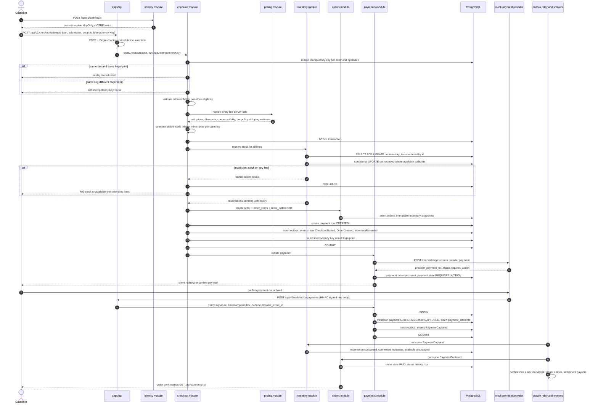

# Checkout Sequence

Status: Phase 0 (design). This is the full checkout flow for a multi-vendor cart: one customer-facing order split into one `seller_orders` row per store, one payment per customer order, atomic inventory reservation, and failure-path recovery. Money values below are illustrative, not measured.

## 1. Main flow

## 2. Multi-vendor split

- A cart may span several stores. The checkout creates **one** `orders` row (customer-facing) and **one** `seller_orders` row per store, each with its own items, shipping, and totals.
- The customer's payment covers the sum of all `seller_orders` totals; each seller order is later fulfilled and settled independently.
- Seller-order totals sum exactly to the order total (integer arithmetic; property test `order-split-sum`).
- Inventory reservations are per line/variant (per store implicitly), released or consumed per seller-order events; a partial cancellation releases only its share.

## 3. Price stability

- Between step "compute stable totals" and payment confirmation, totals are held as the authoritative snapshot on `checkout_attempts` and copied immutably into `orders`/`order_items`.
- If a price changes after reservation but before payment, the checkout uses the reserved snapshot price; a new checkout attempt is required for new prices. This prevents "total changed after I clicked pay" outcomes.
- Coupon application is validated twice: at attempt creation and inside the order-creation transaction (redemption row inserted under the same transaction; unique constraint prevents double redemption).

## 4. Failure paths

### 4.1 Payment fails after reservation

- Webhook `payment_failed` (or mock provider synchronous failure): payment → `FAILED`.
- Worker consumes `PaymentFailed`: seller orders → `CANCELLED`, reservations released (`released`), stock returns to `available`, `OrderCancelled`/`InventoryReleased` events emitted, customer notified.
- The reservation expiry job is a second safety net: even if the failure event is lost, the reservation expires and stock returns (see [inventory-reservation.md](inventory-reservation.md)).

### 4.2 HTTP response lost after order creation

- Client retries `POST /checkout/attempts` with the same `Idempotency-Key`.
- The idempotency record stores the request fingerprint and the result; an identical retry returns the **stored** result (same order id, same totals). No second order, no second reservation, no second payment.
- A retry with the same key but a different payload returns `409 idempotency-key-reuse` (Problem Details).

### 4.3 Duplicate submission (double-click)

- Same as 4.2: both submissions carry the same key; the second is a replay. If a client omits the key, the endpoint rejects the request (`400 missing-idempotency-key`) rather than risking duplication.

### 4.4 Worker crash after provider confirmation, before processing

- The provider's webhook delivery is retried by the provider until a 2xx with proof of processing.
- If the webhook was acknowledged but the transaction never committed, the provider retry re-delivers; idempotent handler dedupes `provider_event_id` only **after** commit (`inbox_processed_events` written in the same transaction), so a crash before commit causes clean reprocessing.
- If the provider stops retrying entirely, the reconciliation job (Phase 6) compares provider state for `REQUIRES_ACTION`/`AUTHORIZED` payments older than a threshold and re-requests status.

### 4.5 Order persisted but outbox publish failed

- Impossible by construction: `outbox_events` rows are inserted in the same DB transaction as the order. A crash after commit leaves unpublished rows that the relay will pick up (`published_at IS NULL` partial index).
- If the relay itself crashes mid-publish, the event is re-published (at-least-once); consumers dedupe via `inbox_processed_events`. See [outbox-processing.md](outbox-processing.md).

### 4.6 Reservation expiry vs. late payment (race)

- Reservations carry `expires_at`. The expiry job releases `pending` reservations past expiry **except** those already `confirmed` by capture.
- Race resolution: capture processing and expiry job both lock the reservation row (`FOR UPDATE`); whichever commits first wins, the other sees state != `pending` and takes no action. A capture arriving after release is handled as a documented edge case: payment is auto-refunded and the order cancelled (`payment-after-expiry` flow), never silently keeping money without stock.

## 5. Idempotency key rules

| Rule     | Value                                                                                                                      |
| -------- | -------------------------------------------------------------------------------------------------------------------------- |
| Scope    | per actor + operation (e.g. `user:…:checkout.create`)                                                                      |
| Storage  | `checkout_attempts.idempotency_key` + `request_fingerprint_hash` (SHA-256 of canonicalized request body) + stored response |
| Replay   | identical fingerprint → stored result, `Idempotency-Replayed: true` header                                                 |
| Conflict | different fingerprint → 409 `idempotency-key-reuse`                                                                        |
| TTL      | retained at least 24h (configured default); older keys may be purged                                                       |
| Required | yes for `POST /checkout/attempts`, payment capture/refund endpoints                                                        |

## 6. Validation and authorization checkpoints

1. Session or guest identity resolved; guest checkout is Phase-later — Phase 0 requires an authenticated `customer`.
2. CSRF double-submit + Origin/Sec-Fetch-Site checks (cookie-auth POST).
3. zod body validation with strict schemas; unknown fields rejected.
4. Ownership: every cart/line/address belongs to the actor; another user's cart → `404` (not `403`, to avoid resource-existence leaks).
5. Server-side eligibility per store (suspended stores rejected), per-product (unpublished rejected).
6. Totals computed only server-side; any client-sent total is ignored by schema (not accepted fields).
