# Database Design — ERD and Data Policies

Status: Phase 0 (design). PostgreSQL 17/18 is the transactional source of truth (ADR-003); the ORM is Drizzle with SQL migrations generated by drizzle-kit (ADR-004). This document shows a **high-level** ERD — not every column — plus the policies that govern identifiers, timestamps, money, deletion, constraints, isolation, and pagination.

## 1. High-level ERD

Relationship cardinality notation: `||--o{` one-to-many, `}o--o{` many-to-many via a junction table. Only key FK columns are shown.

```mermaid
erDiagram
    users ||--o{ user_profiles : "has"
    users ||--o{ user_roles : "granted"
    users ||--o{ sessions : "holds"
    users ||--o{ authentication_events : "generates"
    users ||--o{ email_verification_tokens : "verifies"
    users ||--o{ password_reset_tokens : "resets"
    users ||--o{ mfa_credentials : "enrolls"

    users ||--o{ sellers : "registers"
    sellers ||--o{ stores : "owns"
    stores ||--o{ store_members : "staffed_by"
    users ||--o{ store_members : "joins"
    sellers ||--o{ seller_verifications : "submits"

    categories ||--o{ categories : "parent_of"
    stores ||--o{ products : "lists"
    categories ||--o{ products : "categorizes"
    products ||--o{ product_variants : "has"
    products ||--o{ product_images : "shows"
    products ||--o{ product_attributes : "describes"

    product_variants ||--|| inventory_items : "tracked_as"
    inventory_items ||--o{ inventory_movements : "moves"
    inventory_items ||--o{ inventory_reservations : "reserves"
    checkout_attempts ||--o{ inventory_reservations : "holds"

    products ||--o{ price_records : "priced_by"
    product_variants ||--o{ price_records : "priced_by"
    promotions ||--o{ coupon_redemptions : "redeemed_as"
    users ||--o{ coupon_redemptions : "redeems"

    users ||--o{ carts : "owns"
    carts ||--o{ cart_items : "contains"
    product_variants ||--o{ cart_items : "referenced_in"

    users ||--o{ checkout_attempts : "starts"
    users ||--o{ orders : "places"
    checkout_attempts ||--o{ orders : "creates"
    orders ||--o{ order_items : "contains"
    orders ||--o{ seller_orders : "splits_into"
    stores ||--o{ seller_orders : "fulfills"
    orders ||--o{ order_status_history : "history"

    orders ||--o{ payments : "paid_by"
    payments ||--o{ payment_attempts : "attempts"
    payments ||--o{ refunds : "refunded_by"
    orders ||--o{ returns : "returned_via"

    seller_orders ||--o{ shipments : "shipped_via"
    shipments ||--o{ shipment_events : "tracks"

    ledger_accounts ||--o{ ledger_entries : "posts_to"
    ledger_transactions ||--o{ ledger_entries : "contains"
    commission_rules ||--o{ seller_settlements : "governs"
    sellers ||--o{ seller_settlements : "settled"
    seller_settlements ||--o{ payout_records : "pays_via"

    users ||--o{ product_reviews : "writes"
    products ||--o{ product_reviews : "receives"
    product_reviews ||--o{ review_votes : "voted_on"
    users ||--o{ wishlists : "owns"
    products ||--o{ wishlists : "listed_in"

    users ||--o{ notifications : "receives"
    notifications ||--o{ notification_deliveries : "delivered_via"

    moderation_cases ||--o{ audit_events : "audited_in"
    users ||--o{ audit_events : "acts"

    outbox_events ||--o{ inbox_processed_events : "deduped_by"
```

### Entity notes (key columns only)

| Entity                    | Key columns (abridged)                                                                                                           | Notes                                             |
| ------------------------- | -------------------------------------------------------------------------------------------------------------------------------- | ------------------------------------------------- |
| users                     | id, email citext unique, password_hash, status, email_verified_at                                                                | Argon2id hash only                                |
| user_profiles             | user_id, display_name, locale, timezone                                                                                          |                                                   |
| user_roles                | user_id, role enum, granted_by, granted_at                                                                                       | unique (user_id, role)                            |
| sessions                  | id, token_hash unique, user_id, issued_at, expires_at, revoked_at, ip, user_agent                                                | raw token never stored                            |
| authentication_events     | id, user_id nullable, event_type, ip, user_agent, occurred_at                                                                    | login success/failure, lockout                    |
| email_verification_tokens | id, user_id, token_hash, expires_at, consumed_at                                                                                 | single use                                        |
| password_reset_tokens     | id, user_id, token_hash, expires_at, consumed_at                                                                                 | single use                                        |
| mfa_credentials           | id, user_id, type, secret_ciphertext, confirmed_at                                                                               | TOTP, later phase                                 |
| sellers                   | id, user_id, legal_name, status enum, commission_profile                                                                         | status: pending/verified/suspended                |
| stores                    | id, seller_id, slug unique, name, status                                                                                         |                                                   |
| store_members             | store_id, user_id, role enum, invited_by                                                                                         | unique (store_id, user_id)                        |
| seller_verifications      | id, seller_id, document_object_key, state, reviewed_by, reviewed_at                                                              | documents in MinIO                                |
| categories                | id, parent_id nullable, slug unique, path                                                                                        | ltree or path string                              |
| products                  | id, store_id, category_id, title, slug unique per store, state enum, published_at                                                | state: draft/published/archived                   |
| product_variants          | id, product_id, sku unique per store, attributes jsonb                                                                           |                                                   |
| product_images            | id, product_id, object_key, alt_text, position                                                                                   |                                                   |
| product_attributes        | id, product_id, name, value                                                                                                      | typed catalog attributes                          |
| inventory_items           | id, variant_id unique, on_hand, reserved, committed, version                                                                     | CHECK on_hand/reserved/committed >= 0             |
| inventory_movements       | id, inventory_item_id, delta, reason enum, ref_type, ref_id, created_at                                                          | append-only                                       |
| inventory_reservations    | id, inventory_item_id, checkout_attempt_id, quantity, state enum, expires_at, released_at                                        |                                                   |
| carts                     | id, user_id nullable, guest_token_hash nullable, currency                                                                        | one active cart per user                          |
| cart_items                | id, cart_id, variant_id, quantity                                                                                                | unique (cart_id, variant_id)                      |
| price_records             | id, variant_id, currency, amount_minor, valid_from, valid_to nullable                                                            | no float columns                                  |
| promotions                | id, code unique, type enum, percent_off_minor / amount_off_minor, starts_at, ends_at, max_redemptions                            |                                                   |
| coupon_redemptions        | id, promotion_id, user_id, order_id nullable, state                                                                              | unique (promotion_id, user_id, order_id)          |
| checkout_attempts         | id, user_id, idempotency_key, request_fingerprint_hash, state enum, totals jsonb snapshot, expires_at                            | unique (user_id, operation, idempotency_key)      |
| orders                    | id, user_id, checkout_attempt_id, currency, totals jsonb immutable snapshots, state enum, placed_at                              |                                                   |
| order_items               | id, order_id, variant_id, quantity, unit_price_minor, discount_minor, tax_minor, commission_minor, currency                      | snapshot columns immutable                        |
| seller_orders             | id, order_id, store_id, state enum, subtotal_minor, shipping_minor, total_minor                                                  |                                                   |
| order_status_history      | id, order_id, from_state, to_state, actor_type, actor_id, occurred_at                                                            | append-only                                       |
| payments                  | id, order_id, provider, provider_payment_ref, state enum, amount_minor, currency                                                 | unique (provider, provider_payment_ref)           |
| payment_attempts          | id, payment_id, action enum, provider_event_id nullable, request_hash, response_code, created_at                                 | unique (provider, provider_event_id)              |
| refunds                   | id, payment_id, order_id, amount_minor, currency, state, provider_refund_ref unique                                              |                                                   |
| returns                   | id, order_id, seller_order_id, state, reason, created_at                                                                         |                                                   |
| shipments                 | id, seller_order_id, carrier, tracking_number, state, dispatched_at, delivered_at                                                |                                                   |
| shipment_events           | id, shipment_id, state, occurred_at, source                                                                                      | append-only                                       |
| ledger_accounts           | id, code unique, kind enum asset/liability/revenue/expense, owner_type, owner_id, currency                                       |                                                   |
| ledger_transactions       | id, idempotency_key unique, cause_type, cause_id, posted_at, description                                                         | immutable                                         |
| ledger_entries            | id, transaction_id, account_id, direction enum debit/credit, amount_minor, currency                                              | per-currency balance enforced in service + checks |
| commission_rules          | id, scope enum global/category/store, percent_bp, effective_from, effective_to                                                   | basis points, integer                             |
| seller_settlements        | id, seller_id, period_start, period_end, gross_minor, commission_minor, refunds_minor, net_minor, currency, state                |                                                   |
| payout_records            | id, settlement_id, provider_ref, amount_minor, state, paid_at                                                                    | no bank PAN storage                               |
| product_reviews           | id, product_id, user_id, order_id, rating smallint, body, state, moderation_case_id nullable                                     | unique (product_id, user_id), rating 1..5 CHECK   |
| review_votes              | id, review_id, user_id, vote smallint                                                                                            | unique (review_id, user_id)                       |
| wishlists                 | id, user_id, product_id                                                                                                          | unique (user_id, product_id)                      |
| notifications             | id, user_id, type, payload jsonb, read_at                                                                                        |                                                   |
| notification_deliveries   | id, notification_id, channel, state, attempts, last_error, sent_at                                                               | unique (notification_id, channel)                 |
| moderation_cases          | id, target_type, target_id, state, opened_by, resolved_by, resolution                                                            |                                                   |
| audit_events              | id, actor_type, actor_id, action, target_type, target_id, request_id, trace_id, ip, outcome, occurred_at                         | append-only                                       |
| outbox_events             | id uuidv7, aggregate_type, aggregate_id, event_type, schema_version, payload jsonb, occurred_at, published_at nullable, attempts |                                                   |
| inbox_processed_events    | id, consumer_name, event_id, processed_at, result                                                                                | unique (consumer_name, event_id)                  |

## 2. Identifier strategy

- All primary keys are **UUIDv7 generated application-side** (ADR-005), monotonic within a process: time-ordered, index-friendly, no central sequence, safe to generate in batches.
- UUIDs are stored as native `uuid` columns; generation happens in `packages/shared-kernel` (single implementation).
- External references (idempotency keys, provider refs, tracking numbers) are stored as-is with uniqueness constraints; they are never silently normalized (literal preservation).

## 3. Timestamp policy

- Every table with time semantics uses `timestamptz` (never `timestamp`), stored in **UTC**.
- Application code converts to user timezone only at presentation boundaries.
- All time comparisons (expiry, token TTL) happen in UTC server-side.

## 4. Money representation

- Integer **minor units** + ISO-4217 `currency` code on every monetary column (ADR-006). No `float`, no `double`, no `numeric` for money.
- A per-currency minor-unit scale table in `packages/shared-kernel` maps currency → decimal places (e.g. USD → 2, JPY → 0); rounding rules are explicit and tested.
- Order items hold **immutable snapshots**: `unit_price_minor`, `discount_minor`, `tax_minor`, `commission_minor` at order time. Later price/commission changes never rewrite them.
- The double-entry ledger must balance per currency: sum of entries in a transaction = 0 for each currency (property test).

## 5. Deletion policy

| Data class                          | Policy                                                                                                                  | Rationale                                |
| ----------------------------------- | ----------------------------------------------------------------------------------------------------------------------- | ---------------------------------------- |
| Users (account deletion request)    | Soft: `status = deleted`, PII scrubbed from profile after retention window; rows kept where referenced by orders/ledger | Financial traceability (legal-retention) |
| Sessions, tokens                    | Hard delete on expiry/revocation + periodic purge job                                                                   | No value after expiry                    |
| Products, variants                  | Soft-delete (`archived` state); hard delete only for never-ordered drafts                                               | FK references from orders                |
| Orders, order items, ledger entries | **Never deleted**; corrections via refunds/compensating ledger entries                                                  | Immutability, audit                      |
| audit_events                        | Never deleted by runtime role (no UPDATE/DELETE grant); retention via time-partition drop policy if ever needed         | Integrity                                |
| Reviews, moderation cases           | Soft (hidden state), never hard                                                                                         | Moderation audit                         |
| Notifications, deliveries           | Hard delete after retention window (default 90 days, configurable)                                                      | Volume control                           |
| Inventory movements/reservations    | Append-only; released/expired rows kept                                                                                 | Forensics                                |

Legal-retention note: this is a portfolio project; retention windows are **configured defaults**, not a legal opinion. See [../security/security-architecture.md](../security/security-architecture.md) for the retention table.

## 6. Key constraints and indexes — rationale

- **Uniqueness**: `users.email`; `sessions.token_hash`; `checkout_attempts (user_id, operation, idempotency_key)`; `payments (provider, provider_payment_ref)`; `payment_attempts (provider, provider_event_id)`; `inbox_processed_events (consumer_name, event_id)`; `ledger_transactions.idempotency_key`; `product_reviews (product_id, user_id)`; `carts` one active per user (partial unique index on `user_id WHERE closed_at IS NULL`).
- **CHECK constraints**: `inventory_items` non-negative columns; `order_items` non-negative quantities and `amount_minor` bounds; `review_votes.vote IN (-1, 1)`; `product_reviews.rating BETWEEN 1 AND 5`.
- **FK indexes**: every FK column indexed (PostgreSQL does not do this automatically) — hot join paths: `order_items.order_id`, `seller_orders.order_id`, `inventory_reservations.expires_at WHERE state = 'pending'`, `outbox_events.published_at IS NULL`.
- **Partial indexes** for state machines: e.g. `outbox_events (occurred_at) WHERE published_at IS NULL`, `sessions (user_id) WHERE revoked_at IS NULL`, `inventory_reservations (expires_at) WHERE state = 'pending'`.
- **Text search**: GIN index on `to_tsvector` for products (title/description) behind the search repository boundary (ADR-012).
- **JSONB** is used only for snapshots and payloads (`order totals`, event payloads), never as a substitute for a relational invariant.

## 7. Transaction isolation decisions

- Default isolation: **READ COMMITTED** — adequate for the write patterns used, because correctness relies on explicit locking and constraints rather than repeatable reads.
- Contended resources (inventory rows) use **`SELECT ... FOR UPDATE`** with a deterministic lock order (by `inventory_item_id` ascending) to avoid deadlocks; conditional `UPDATE ... WHERE` guards and CHECK constraints back this up (ADR-008). See [inventory-reservation.md](inventory-reservation.md) for the SQL.
- Checkout's order creation transaction takes reservation locks first, then order rows; no transaction mixes the two orders in reverse order.
- The outbox relay reads unpublished events with `FOR UPDATE SKIP LOCKED` so multiple relay instances cooperate without contention.
- Serializable isolation is deliberately not the default: it would trade throughput for guarantees we already get from locking + constraints, and its abort-retry behavior complicates idempotency handling. Revisit if a write pattern cannot be safely locked.

## 8. Cursor pagination keys

- Large lists (orders, products, audit events, settlements) use **cursor pagination**, never `OFFSET`.
- Cursor = opaque base64url token encoding `(sort_key, id)`; for time-descending lists `sort_key = created_at`, tie-broken by `id` (uuidv7 gives a stable total order).
- Query form: `WHERE (created_at, id) < (:cursor_created_at, :cursor_id) ORDER BY created_at DESC, id DESC LIMIT :n` (row-value comparison).
- Cursor tokens are validated as opaque strings by zod before decoding; tampered cursors return Problem Details `invalid-cursor`.
- Small bounded lists (e.g. roles of a user) may use simple limits.

## 9. Migration mechanics

- Drizzle-kit generates SQL migrations; migrations are committed and reviewed, applied by `pnpm db:migrate` using the dedicated **migration DB role** (DDL rights), while the runtime role has DML only (ADR-004).
- Destructive changes follow expand/contract: see [../operations/database-migrations.md](../operations/database-migrations.md).
- Migration verification runs in CI (apply from empty, apply from previous release snapshot).
