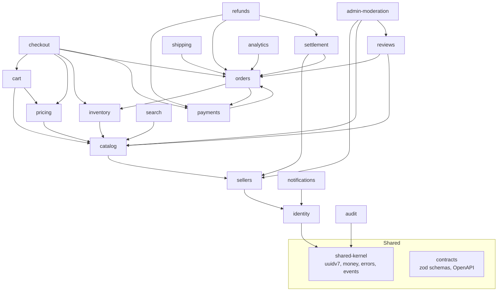

# Domain Boundaries — 18 Bounded Contexts

Status: Phase 0 (design). Table ownership is exclusive: exactly one module may write a table. Cross-module writes go through application interfaces or domain/integration events. Module dependency direction is **downward only** — the dependency graph must remain acyclic (enforced by lint rules and CI review).

## 1. Module dependency rule

- A module may depend on `packages/shared-kernel` and `packages/contracts` freely.
- A module may depend on another module's **application interface** (a narrow, typed port) or on its **published events**, never on its internal repositories or entities.
- Cycles are a build failure in practice: `apps/api` module wiring is reviewed in PRs, and `import/no-cycle` (or equivalent) covers module imports.
- Read-side composition (e.g. an admin dashboard query spanning orders and sellers) is done via read models/queries that join across schemas without creating module-to-module write coupling.

## 2. Contexts

### 2.1 Identity & Access (`identity`)

- **Responsibility:** user accounts, credentials, sessions, email verification, password reset, MFA (later phase), role assignment, authentication events.
- **Owned tables:** `users`, `user_profiles`, `user_roles`, `sessions`, `authentication_events`, `email_verification_tokens`, `password_reset_tokens`, `mfa_credentials`.
- **Published events:** `UserRegistered`, `UserEmailVerified`, `UserRoleChanged`, `UserDeactivated`, `SessionRevoked`.
- **Consumed events:** none required (root context); consumes `SellerApproved` only for optional profile hints.
- **Module dependencies:** shared-kernel only.
- **Invariants it owns:**
  - Passwords are stored only as Argon2id hashes; plaintext passwords never persist or log.
  - A session token is stored SHA-256 hashed; raw tokens exist only in the client cookie.
  - Session rotation occurs on login and privilege elevation.
  - Password-reset tokens are single-use, time-limited, and stored hashed.
  - Only `administrator` may assign `administrator`/`moderator` roles; role changes are audited.

### 2.2 Sellers & Stores (`sellers`)

- **Responsibility:** seller onboarding, store profiles, store membership and staff, verification workflow, suspension state.
- **Owned tables:** `sellers`, `stores`, `store_members`, `seller_verifications`.
- **Published events:** `SellerRegistered`, `SellerVerificationSubmitted`, `SellerApproved`, `SellerSuspended`, `StoreUpdated`, `StoreMemberAdded`, `StoreMemberRemoved`.
- **Consumed events:** `UserRegistered` (provision seller profile on request), `ModerationCaseResolved` (reinstate/suspend effects).
- **Module dependencies:** identity (application interface for user lookup).
- **Invariants it owns:**
  - Only verified/approved sellers may publish products or receive payouts (state checks enforced server-side).
  - Store membership grants scoped `seller_staff` access limited to the stores they belong to.
  - Suspension blocks new orders at affected stores and is reversible with audit trail.

### 2.3 Catalog (`catalog`)

- **Responsibility:** categories, products, variants, images, attributes, publish state.
- **Owned tables:** `categories`, `products`, `product_variants`, `product_images`, `product_attributes`.
- **Published events:** `ProductCreated`, `ProductUpdated`, `ProductPublished`, `ProductUnpublished`, `ProductArchived`.
- **Consumed events:** `SellerSuspended` (unpublish store products), `MediaProcessed` (attach re-encoded images).
- **Module dependencies:** sellers (store ownership checks), shared-kernel.
- **Invariants it owns:**
  - Products belong to exactly one store; only store members edit them.
  - Published products have at least one variant with a price record in pricing.
  - Product content is data only; uploaded media is referenced by object key, never executed.

### 2.4 Inventory (`inventory`)

- **Responsibility:** stock quantities, stock movements, reservations tied to checkout attempts.
- **Owned tables:** `inventory_items`, `inventory_movements`, `inventory_reservations`.
- **Published events:** `InventoryReserved`, `InventoryReservationConfirmed`, `InventoryReservationExpired`, `InventoryReleased`, `StockAdjusted`.
- **Consumed events:** `OrderCreated` (convert reservation to committed), `OrderCancelled` (release), `PaymentCaptured` (confirm consumption), `RefundCompleted` (restock decision), `CheckoutStarted`.
- **Module dependencies:** catalog (variant identity), shared-kernel.
- **Invariants it owns (enforced with constraints + locking, see [inventory-reservation.md](inventory-reservation.md)):**
  - `available >= 0` at all times (CHECK constraint).
  - `available + reserved + committed = on_hand` as the stock accounting identity.
  - Reservations have explicit states and expiry timestamps; expired reservations are recoverable even after worker downtime.
  - No Redis locks for correctness; PostgreSQL row locks only.

### 2.5 Pricing & Promotions (`pricing`)

- **Responsibility:** price records, promotions, coupon definitions and redemption tracking, tax/shipping policy inputs.
- **Owned tables:** `price_records`, `promotions`, `coupon_redemptions`.
- **Published events:** `PriceChanged`, `CouponRedeemed`, `CouponRejected`, `PromotionEnded`.
- **Consumed events:** `OrderCreated` (record redemptions), `OrderCancelled` (release redemption counts).
- **Module dependencies:** catalog (product/variant identity), shared-kernel.
- **Invariants it owns:**
  - Money is integer minor units + ISO-4217 code (ADR-006); no floats ever.
  - Coupon validity (dates, usage caps, per-customer caps, applicable products) is decided server-side at checkout and again at order creation.
  - Recalculation is deterministic: same inputs produce the same totals.

### 2.6 Cart (`cart`)

- **Responsibility:** shopping carts and line items for guests and customers.
- **Owned tables:** `carts`, `cart_items`.
- **Published events:** `CartUpdated`, `CartAbandoned` (later phase).
- **Consumed events:** `ProductUnpublished` (flag/remove invalid lines), `PriceChanged` (mark stale prices).
- **Module dependencies:** catalog, pricing (read), shared-kernel.
- **Invariants it owns:**
  - Cart totals are advisory only; **checkout always reprices server-side** — the cart never determines charged amounts.

### 2.7 Checkout (`checkout`)

- **Responsibility:** orchestrating checkout attempts: eligibility, repricing, coupon/tax/shipping application, inventory reservation, order creation, payment initiation, idempotency keys.
- **Owned tables:** `checkout_attempts`, `orders`, `order_items`, `seller_orders`, `order_status_history` (owned jointly with Orders below: Orders owns `orders`/`order_items`/`seller_orders`/`order_status_history` writes after hand-off; Checkout owns `checkout_attempts` and the creation transaction).
- **Published events:** `CheckoutStarted`, `OrderCreated`, `CheckoutFailed`.
- **Consumed events:** `InventoryReservationExpired`, `PaymentFailed`, `PaymentCaptured`.
- **Module dependencies:** cart, pricing, inventory, orders (creation port), payments (initiation port), shared-kernel.
- **Invariants it owns:**
  - Idempotency keys are scoped per actor + operation with a persisted request fingerprint; reuse with a different payload is rejected.
  - One customer-facing order splits into one `seller_orders` row per store; customer pays once.
  - Order items carry immutable monetary snapshots (price, discount, tax, commission at time of order).
  - Clients can never set price, role, status, ownership, or totals.

### 2.8 Orders (`orders`)

- **Responsibility:** order lifecycle after creation: state transitions, cancellation, status history, seller-order state.
- **Owned tables:** `orders`, `order_items`, `seller_orders`, `order_status_history`.
- **Published events:** `OrderCancelled`, `OrderCompleted`, `SellerOrderShipped`, `OrderStatusChanged`.
- **Consumed events:** `PaymentCaptured`, `PaymentFailed`, `RefundCompleted`, `ShipmentDispatched`.
- **Module dependencies:** inventory (release port), payments (state read), shared-kernel.
- **Invariants it owns:**
  - Order state transitions follow a documented table; invalid transitions are rejected (property-tested).
  - Monetary fields on created order rows are immutable; corrections happen via refunds/compensating ledger entries.
  - Customer-visible totals equal the sum of per-seller orders and items (integer arithmetic).

### 2.9 Payments (`payments`)

- **Responsibility:** payment provider abstraction, payment and attempt records, webhook ingestion, signature verification, payment state machine.
- **Owned tables:** `payments`, `payment_attempts`.
- **Published events:** `PaymentInitiated`, `PaymentAuthorized`, `PaymentCaptured`, `PaymentFailed`, `PaymentCancelled`, `PaymentRefundRequested`.
- **Consumed events:** `OrderCreated` (initiate), `CheckoutFailed` (cancel), `OrderCancelled` (cancel/void).
- **Module dependencies:** orders (read-only order identity), shared-kernel.
- **Invariants it owns (see [payment-workflow.md](payment-workflow.md)):**
  - Payment state transitions follow the documented table; invalid transitions rejected.
  - Provider event IDs are deduplicated; webhooks are verified (HMAC over raw body, timestamp tolerance) before processing.
  - PAN/CVV are never stored, logged, or proxied; the mock provider uses tokenized test instruments only.

### 2.10 Refunds & Returns (`refunds`)

- **Responsibility:** refund requests/approvals, return merchandise authorization, refund execution against provider.
- **Owned tables:** `refunds`, `returns`.
- **Published events:** `RefundRequested`, `RefundApproved`, `RefundCompleted`, `ReturnRequested`, `ReturnReceived`.
- **Consumed events:** `PaymentCaptured`, `ModerationCaseResolved`.
- **Module dependencies:** payments (refund port), orders (read), ledger (compensation hook), shared-kernel.
- **Invariants it owns:**
  - Refund amount never exceeds captured amount minus already-refunded amount (per currency).
  - Refunds are retried idempotently against the provider using a stable refund reference.
  - Approval requires `support_agent`+ per access matrix; sellers can request, not approve.

### 2.11 Seller Settlement (`settlement`)

- **Responsibility:** commission rules, payable computation, settlement runs, payout records.
- **Owned tables:** `ledger_accounts`, `ledger_transactions`, `ledger_entries`, `commission_rules`, `seller_settlements`, `payout_records`.
- **Published events:** `SettlementRunCreated`, `SellerPaid`, `CommissionRuleChanged`.
- **Consumed events:** `PaymentCaptured`, `RefundCompleted`, `SellerApproved`, `SellerSuspended`.
- **Module dependencies:** sellers, orders (snapshots read), shared-kernel.
- **Invariants it owns:**
  - Double-entry: every transaction's entries sum to zero per currency; transactions are immutable; corrections are compensating transactions.
  - Commission comes from the order-item snapshot at sale time; later `commission_rules` changes never rewrite history.
  - This is a portfolio demonstration ledger, not legally certified accounting (stated in [../portfolio-case-study.md](../portfolio-case-study.md)).

### 2.12 Shipping & Fulfillment (`shipping`)

- **Responsibility:** shipment creation per seller order, shipment events/tracking, delivery state, shipping rate estimates (policy interface).
- **Owned tables:** `shipments`, `shipment_events`.
- **Published events:** `ShipmentCreated`, `ShipmentDispatched`, `ShipmentDelivered`, `ShipmentFailed`.
- **Consumed events:** `OrderCreated`, `OrderCancelled`.
- **Module dependencies:** orders, shared-kernel.
- **Invariants it owns:**
  - A shipment belongs to exactly one `seller_orders` row.
  - Shipping rate providers sit behind an isolated interface; the demo policy is deterministic.

### 2.13 Reviews & Ratings (`reviews`)

- **Responsibility:** product reviews, ratings aggregation, review votes.
- **Owned tables:** `product_reviews`, `review_votes`.
- **Published events:** `ReviewCreated`, `ReviewModerated`, `ReviewVoted`.
- **Consumed events:** `OrderCompleted` (eligibility: only purchasers review), `ModerationCaseResolved`.
- **Module dependencies:** orders (purchase check), catalog (product identity), shared-kernel.
- **Invariants it owns:**
  - One review per customer per product; votes are one per user per review.
  - Moderation hides content without destroying it (audit preserved).

### 2.14 Search (`search`)

- **Responsibility:** full-text search over published catalog data behind a repository boundary; indexing projections.
- **Owned tables:** none of its own in Phase 0 — reads catalog-owned tables via a read-only projection; index rebuild scripts live in `scripts/`.
- **Published events:** `SearchIndexChanged` (observability only).
- **Consumed events:** `ProductPublished`, `ProductUpdated`, `ProductUnpublished`, `ReviewCreated`.
- **Module dependencies:** catalog (read model), shared-kernel.
- **Invariants it owns:**
  - The public search API shape is stable regardless of engine; PostgreSQL FTS today, OpenSearch can replace it without public API changes (ADR-012).
  - Search results only include products in `published` state and from non-suspended stores.

### 2.15 Notifications (`notifications`)

- **Responsibility:** notification templates, delivery attempts, email dispatch, user notification preferences.
- **Owned tables:** `notifications`, `notification_deliveries`.
- **Published events:** `NotificationSent`, `NotificationFailed`.
- **Consumed events:** `UserRegistered`, `OrderCreated`, `PaymentCaptured`, `ShipmentDispatched`, `RefundCompleted`, `InventoryReservationExpired` (internal ops alert).
- **Module dependencies:** identity (contact info port), shared-kernel.
- **Invariants it owns:**
  - Notifications carry no secrets and minimal personal data.
  - Delivery is at-least-once with idempotent enqueue keyed by event id + template.

### 2.16 Administration & Moderation (`admin`)

- **Responsibility:** moderation cases (reviews, listings, sellers), suspension actions, admin tooling, support tooling access.
- **Owned tables:** `moderation_cases`.
- **Published events:** `ModerationCaseOpened`, `ModerationCaseResolved`, `StoreSuspendedByModeration`, `UserWarned`.
- **Consumed events:** `ReviewCreated`, `SellerVerificationSubmitted`, reports from other contexts.
- **Module dependencies:** sellers, catalog, reviews (command ports), shared-kernel.
- **Invariants it owns:**
  - Moderator actions are scoped: moderation has no unrestricted financial access (see [../security/access-control-matrix.md](../security/access-control-matrix.md)).
  - Every privileged action writes an `audit_events` row via the audit context.

### 2.17 Audit & Compliance (`audit`)

- **Responsibility:** append-only audit trail of security- and money-relevant actions, retention enforcement, data-export/deletion request tracking (considerations only).
- **Owned tables:** `audit_events`.
- **Published events:** `AuditEventRecorded` (internal).
- **Consumed events:** command calls from all modules (audit is written synchronously in the same transaction as privileged changes where feasible).
- **Module dependencies:** shared-kernel; called by every module through a single `AuditPort`.
- **Invariants it owns:**
  - `audit_events` is append-only (no UPDATE/DELETE grants for runtime role).
  - Each entry records actor, action, target, request-id/trace-id, timestamp, and outcome.

### 2.18 Analytics & Reporting (`analytics`)

- **Responsibility:** read-side aggregations for dashboards (sales, conversion, settlement summaries); future extraction candidate.
- **Owned tables:** none (read-only projections from owned tables of other contexts; later: `analytics_*` rollup tables owned by analytics).
- **Published events:** none.
- **Consumed events:** `OrderCreated`, `PaymentCaptured`, `RefundCompleted`, `ShipmentDelivered` (rollup refresh).
- **Module dependencies:** read-only access via reporting queries; no write coupling.
- **Invariants it owns:**
  - Analytics never feeds back into transactional writes; dashboards may lag reality.

### Cross-cutting (not a bounded context)

- `outbox_events` and `inbox_processed_events` are infrastructure tables owned by the shared-kernel outbox/inbox library (see [outbox-processing.md](outbox-processing.md)); no business module writes them directly except through the outbox API inside its transaction.

## 3. Module dependency diagram

Diagram notes:

- `payments → orders` is read-only (order identity/state lookup); `orders → payments` uses the payment state port. If this pair risks a cycle in implementation, resolve by extracting a tiny `order-identity` read port owned by orders and consumed by payments only, keeping the code dependency one-directional.
- `checkout` is the composition root of the purchase flow and is allowed to depend on several contexts through interfaces.
- Everything depends on shared-kernel/contracts; those depend on nothing internal.

## 4. Event ownership summary

| Context       | Publishes                                                                                                              | Consumes                                                                                                        |
| ------------- | ---------------------------------------------------------------------------------------------------------------------- | --------------------------------------------------------------------------------------------------------------- |
| identity      | UserRegistered, UserEmailVerified, UserRoleChanged, UserDeactivated, SessionRevoked                                    | —                                                                                                               |
| sellers       | SellerRegistered, SellerVerificationSubmitted, SellerApproved, SellerSuspended, StoreUpdated, StoreMemberAdded/Removed | UserRegistered, ModerationCaseResolved                                                                          |
| catalog       | ProductCreated/Updated/Published/Unpublished/Archived                                                                  | SellerSuspended, MediaProcessed                                                                                 |
| inventory     | InventoryReserved, InventoryReservationConfirmed, InventoryReservationExpired, InventoryReleased, StockAdjusted        | CheckoutStarted, OrderCreated, OrderCancelled, PaymentCaptured, RefundCompleted                                 |
| pricing       | PriceChanged, CouponRedeemed, CouponRejected, PromotionEnded                                                           | OrderCreated, OrderCancelled                                                                                    |
| cart          | CartUpdated                                                                                                            | ProductUnpublished, PriceChanged                                                                                |
| checkout      | CheckoutStarted, OrderCreated, CheckoutFailed                                                                          | InventoryReservationExpired, PaymentFailed, PaymentCaptured                                                     |
| orders        | OrderCancelled, OrderCompleted, SellerOrderShipped, OrderStatusChanged                                                 | PaymentCaptured, PaymentFailed, RefundCompleted, ShipmentDispatched                                             |
| payments      | PaymentInitiated, PaymentAuthorized, PaymentCaptured, PaymentFailed, PaymentCancelled, PaymentRefundRequested          | OrderCreated, CheckoutFailed, OrderCancelled                                                                    |
| refunds       | RefundRequested, RefundApproved, RefundCompleted, ReturnRequested, ReturnReceived                                      | PaymentCaptured, ModerationCaseResolved                                                                         |
| settlement    | SettlementRunCreated, SellerPaid, CommissionRuleChanged                                                                | PaymentCaptured, RefundCompleted, SellerApproved, SellerSuspended                                               |
| shipping      | ShipmentCreated, ShipmentDispatched, ShipmentDelivered, ShipmentFailed                                                 | OrderCreated, OrderCancelled                                                                                    |
| reviews       | ReviewCreated, ReviewModerated, ReviewVoted                                                                            | OrderCompleted, ModerationCaseResolved                                                                          |
| search        | SearchIndexChanged                                                                                                     | ProductPublished, ProductUpdated, ProductUnpublished, ReviewCreated                                             |
| notifications | NotificationSent, NotificationFailed                                                                                   | UserRegistered, OrderCreated, PaymentCaptured, ShipmentDispatched, RefundCompleted, InventoryReservationExpired |
| admin         | ModerationCaseOpened, ModerationCaseResolved, StoreSuspendedByModeration, UserWarned                                   | ReviewCreated, SellerVerificationSubmitted                                                                      |
| audit         | AuditEventRecorded                                                                                                     | — (synchronous port calls)                                                                                      |
| analytics     | —                                                                                                                      | OrderCreated, PaymentCaptured, RefundCompleted, ShipmentDelivered                                               |

## 5. Enforcement

- PR review checks module import direction; `import/no-cycle` lint rule guards cycles.
- Table ownership is documented in each module's README and enforced by convention: repositories for a table live only in the owning module.
- Contract changes (zod schemas, events) require a version bump per [outbox-processing.md](outbox-processing.md#2-event-envelope) and an ADR note if the envelope changes.
