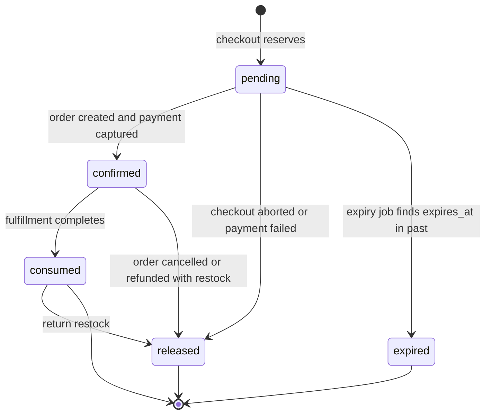

# Inventory Reservation

Status: Phase 0 (design). Inventory correctness is enforced in PostgreSQL with row locks, conditional updates, and CHECK constraints — never with Redis locks (ADR-008). The concurrency test matrix in §6 is a required deliverable; as of Phase 0 these tests are **planned**, not yet written.

## 1. Stock model

Each `inventory_items` row tracks one variant at one store:

| Column      | Meaning                                                                                                      |
| ----------- | ------------------------------------------------------------------------------------------------------------ |
| `on_hand`   | total physical units accounted for                                                                           |
| `reserved`  | units held by pending reservations (checkout attempts in flight)                                             |
| `committed` | units sold (order created / payment captured) and not returned                                               |
| `available` | derived: `on_hand - reserved - committed` (maintained as a real column guarded by CHECK for lock-free reads) |

**Stock accounting identity:** `available + reserved + committed = on_hand`.

Movements (`inventory_movements`, append-only) record every change with a reason: `purchase_restock`, `sale_commit`, `reservation_release`, `reservation_expire`, `return_restock`, `adjustment_damage`, `adjustment_correction`, plus a reference (`ref_type`, `ref_id`) to the business object that caused it.

## 2. Invariants

1. `available >= 0`, `reserved >= 0`, `committed >= 0`, `on_hand >= 0` — CHECK constraints, non-negotiable.
2. A reservation is created only with `quantity <= available` evaluated **under the row lock** in the same transaction.
3. `reserved` increases when a reservation is `pending`; decreases when it is `confirmed` (offset by `committed` increase) or `released`/`expired` (returns to `available`).
4. A variant with zero `on_hand` can still be displayed (back-order policy is out of scope); checkout for it fails with `stock-unavailable`.
5. All stock mutations go through the inventory module; no other module writes `inventory_*` tables.
6. Reservations are scoped to a `checkout_attempt_id` and expire at a fixed TTL (default 30 minutes, configured; rationale: long enough to complete payment, short enough not to hold stock hostage).

## 3. Reservation state machine



| Transition           | Trigger                           | Effect on quantities                                                 |
| -------------------- | --------------------------------- | -------------------------------------------------------------------- |
| → pending            | checkout reservation              | `available −q`, `reserved +q`                                        |
| pending → confirmed  | order/payment confirmed           | `reserved −q`, `committed +q`                                        |
| pending → released   | payment failed / checkout aborted | `reserved −q`, `available +q`                                        |
| pending → expired    | expiry job, `expires_at < now()`  | `reserved −q`, `available +q`                                        |
| confirmed → consumed | fulfillment complete              | no quantity change (state only)                                      |
| confirmed → released | cancellation/refund with restock  | `committed −q`, `available +q`                                       |
| consumed → released  | return received                   | `committed −q`, `available +q` (or `on_hand` +q with `available` +q) |

Every transition is executed under `SELECT ... FOR UPDATE` on the reservation row **and** the inventory row, and writes a matching `inventory_movements` row plus an outbox event in the same transaction.

## 4. Locking strategy

Rules: (a) always lock `inventory_items` rows in ascending `variant_id`/`inventory_item_id` order to prevent deadlocks; (b) lock the reservation row before its inventory row when both are needed; (c) keep transactions short — no network calls inside a lock.

### 4.1 Reserve (checkout)

```sql
-- inside one transaction, rows locked in deterministic order
SELECT id, available, reserved
FROM inventory_items
WHERE variant_id = ANY($1::uuid[])      -- parameterized variant list
ORDER BY id
FOR UPDATE;

-- per line, only if the SELECT showed enough available:
UPDATE inventory_items
SET available = available - $2,         -- $2 = quantity
    reserved  = reserved + $2,
    updated_at = now()
WHERE id = $1                           -- $1 = inventory_item_id
  AND available >= $2;                  -- conditional guard, second line of defense

-- if the UPDATE affects 0 rows: abort with stock-unavailable for that line
INSERT INTO inventory_reservations
  (id, inventory_item_id, checkout_attempt_id, quantity, state, expires_at)
VALUES ($1, $2, $3, $4, 'pending', now() + interval '30 minutes');
```

### 4.2 Confirm (payment captured / order created)

```sql
SELECT id FROM inventory_reservations WHERE id = $1 FOR UPDATE;

UPDATE inventory_reservations
SET state = 'confirmed', confirmed_at = now()
WHERE id = $1 AND state = 'pending';     -- conditional: expiry/other path already won -> 0 rows

-- if 0 rows affected: reservation was expired/released first -> payment-after-expiry path
UPDATE inventory_items
SET reserved = reserved - $2,
    committed = committed + $2
WHERE id = $3;
```

### 4.3 Release / expire

```sql
UPDATE inventory_reservations
SET state = 'expired', released_at = now()
WHERE id = $1 AND state = 'pending' AND expires_at < now();

UPDATE inventory_items
SET reserved = reserved - $2,
    available = available + $2
WHERE id = $3;
```

The conditional `WHERE state = 'pending'` makes release/expire/confirm mutually exclusive: whichever transaction commits first flips the state; the others see zero rows and do nothing (idempotent).

## 5. Expiry recovery workflow

Requirement: recovery must work **even if workers were down** the whole time.

1. On worker start, the expiry processor runs an immediate sweep, then repeats on a fixed interval (default every 60s, configured).
2. Sweep query (partial index `inventory_reservations (expires_at) WHERE state = 'pending'`):

```sql
SELECT id FROM inventory_reservations
WHERE state = 'pending' AND expires_at < now()
ORDER BY expires_at
LIMIT 500
FOR UPDATE SKIP LOCKED;
```

3. For each row: release as in §4.3, write `inventory_movements` (`reservation_expire`), write outbox event `InventoryReservationExpired`.
4. Because `expires_at` is durable in PostgreSQL, a crash, deploy, or Redis flush cannot lose pending expirations — the next sweep finds them.
5. Clock policy: expiry comparisons use database `now()` (UTC) to avoid app-server clock skew.

## 6. Concurrency test matrix (required)

To be implemented in `tests/integration/inventory-concurrency.test.ts` (harness: real PostgreSQL via docker compose infra, `fast-check` for property cases). **Status: planned.**

| #   | Test                                      | Setup                                                                                                           | Expected outcome                                                                                                                                                                                   |
| --- | ----------------------------------------- | --------------------------------------------------------------------------------------------------------------- | -------------------------------------------------------------------------------------------------------------------------------------------------------------------------------------------------- |
| 1   | 100 concurrent buyers vs 10 units         | 100 parallel checkout attempts on a variant with `available = 10`                                               | exactly 10 reservations succeed, 90 fail `stock-unavailable`; `available >= 0` always; `available + reserved + committed = on_hand` at the end; no deadlock errors surfaced                        |
| 2   | Expiry-vs-payment race                    | reservation `pending` with `expires_at` in the past; expiry job and `PaymentCaptured` consumer run concurrently | exactly one of {expired, confirmed} wins; quantities consistent either way; the loser's transition is a no-op; if expired first, payment-after-expiry path triggers auto-refund + `OrderCancelled` |
| 3   | Duplicate checkout (same idempotency key) | 5 parallel identical checkout requests with one `Idempotency-Key`                                               | exactly 1 order, 1 set of reservations; the other 4 receive the stored result; fingerprint mismatch variant returns 409                                                                            |
| 4   | Repeated release events                   | `InventoryReleased` event delivered 5 times                                                                     | stock released exactly once; `inventory_movements` has one release row; consumers dedupe via `inbox_processed_events`                                                                              |
| 5   | Worker crash during processing            | kill worker between reservation insert and consumer commit (fault-injection harness)                            | on restart, redelivery processes the event exactly once in effect; no double-release, no double-commit; outbox row eventually `published_at` set                                                   |
| 6   | Negative-stock attempt (property)         | `fast-check`: random interleavings of reserve/confirm/release sequences                                         | `available >= 0` invariant holds for every interleaving; sum identity holds                                                                                                                        |
| 7   | Lock-order deadlock probe                 | two concurrent checkouts reserving the same two variants in opposite request order                              | no deadlock (deterministic lock order); both succeed or one fails cleanly                                                                                                                          |

## 7. Operational notes

- Metrics to expose (Phase 8): reservation success/failure counts, expiry sweep size, lock wait time histogram, `stock-unavailable` rate per variant.
- If rows are hot (a flash-sale variant), the row lock serializes buyers by design — correctness first; queueing is observable via lock wait metrics.
- Manual repair tooling: `scripts/inventory-repair` (Phase 7) recomputes the identity from `inventory_movements` and flags drift; it must never silently mutate quantities without an audit event.
