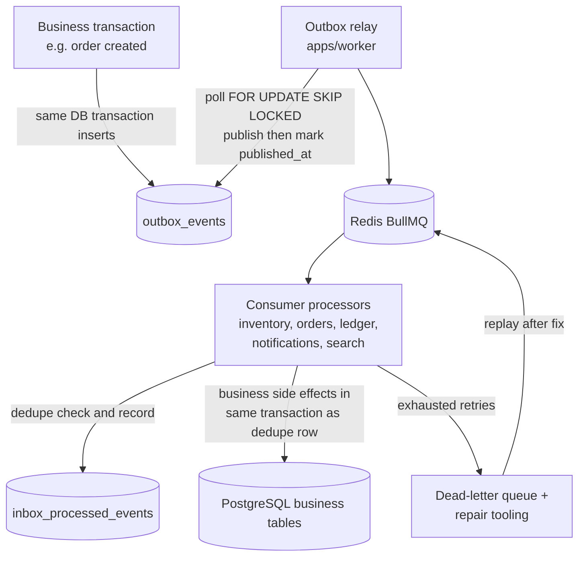

# Transactional Outbox, Event Delivery, and Consumers

Status: Phase 0 (design). Delivery is **at-least-once**; exactly-once _effects_ are achieved with idempotent consumers and a dedupe table. We make no exactly-once delivery claim (ADR-009).

## 1. Workflow



Sequence rules:

1. A business transaction writes its domain rows **and** the matching `outbox_events` rows in one DB transaction. There is no window where one exists without the other.
2. The relay scans `outbox_events WHERE published_at IS NULL ORDER BY occurred_at` with `FOR UPDATE SKIP LOCKED` (multiple relay instances cooperate), enqueues a BullMQ job per event, and sets `published_at` after successful enqueue.
3. If the relay crashes between enqueue and marking published, the event is enqueued again later — a duplicate delivery, handled by consumer dedupe.
4. Consumers process the job: check `inbox_processed_events (consumer_name, event_id)`; if present → ack and stop. Otherwise perform side effects and insert the dedupe row **in the same DB transaction** as those side effects, then ack.
5. Failures retry with bounded exponential backoff (see §5); exhausted retries go to a dead-letter queue **and** are recorded with `attempts` on the outbox row for repair tooling.

## 2. Event envelope

```json
{
  "event_id": "0193a1b2-c3d4-7000-8000-0123456789ab",
  "event_type": "OrderCreated",
  "schema_version": 1,
  "occurred_at": "2026-10-21T12:00:00.000Z",
  "producer": "orders",
  "aggregate_type": "order",
  "aggregate_id": "0193a1b2-...",
  "correlation_id": "0193a1b2-...",
  "causation_id": "0193a1b2-...",
  "payload": {
    "order_id": "0193a1b2-...",
    "user_id": "0193a1b2-...",
    "currency": "USD",
    "total_minor": 129900,
    "seller_order_ids": ["0193a1b2-..."]
  }
}
```

- `event_id` is a UUIDv7 generated app-side at insert time; it is the dedupe key.
- `correlation_id` traces a business flow end-to-end; `causation_id` points to the event that caused this one. Both are logged as trace context.
- `payload` carries **ids and immutable snapshots**, not full entity graphs or PII beyond necessity.

### 2.1 Versioning policy

- `schema_version` is a positive integer per `event_type`, bumped on any breaking payload change (field removed/renamed/type changed). Additive optional fields may stay on the same version only if all consumers tolerate unknown fields (they must — consumers validate with zod schemas in `packages/contracts` that ignore unknown keys on read, while producers emit strict schemas).
- Consumers must accept the current version and at most one previous version during a migration window; a consumer that cannot parse an event routes it to the DLQ with `result = unsupported-version`, never crashes.
- Contract tests in CI validate producer schemas against consumer expectations for every catalog event.

## 3. Delivery guarantees — and their limits

| Guarantee                                    | Status                       | Limit                                                                                 |
| -------------------------------------------- | ---------------------------- | ------------------------------------------------------------------------------------- |
| Business change + event atomically persisted | yes (outbox)                 | relay latency adds seconds, not zero                                                  |
| At-least-once delivery to consumers          | yes                          | duplicates happen; crash between enqueue and mark, provider retries, redeliveries     |
| Exactly-once delivery                        | **no claim**                 | unattainable across process boundaries; we do not pretend                             |
| Exactly-once _effect_ per consumer           | by design, verified by tests | requires every consumer to dedupe + be idempotent; a non-idempotent consumer is a bug |
| No event loss after commit                   | yes                          | outbox rows survive crashes; relay re-scans                                           |
| Event loss before commit                     | n/a                          | transaction rolled back entirely                                                      |

## 4. Ordering guarantees and limitations

- Within one aggregate (e.g. one order), events are emitted in causal order and the relay publishes roughly in `occurred_at` order — but **consumers must not rely on global ordering**. BullMQ with multiple workers can deliver out of order; retries reorder further.
- Ordering-sensitive logic must read current state, not assume sequence (the payment webhook handler in [payment-workflow.md](payment-workflow.md#3-idempotency-and-duplicateout-of-order-webhooks) is the reference example: it guards by state machine).
- Where strict per-aggregate order is genuinely required later, the fix is partitioned queues keyed by `aggregate_id` — deferred until a real need appears (documented as a limitation, not hidden).

## 5. Retry, backoff, dead-letter

- Bounded exponential backoff with jitter: base 5s, factor 3, max 15 attempts or 30 minutes cumulative (configured defaults; rationale: survive transient dependency outages without unbounded queue growth).
- Retryable errors: DB connection failures, provider timeouts, lock timeouts. Non-retryable: validation/schema errors, permanently invalid state — immediate DLQ.
- Dead-letter: BullMQ `failed` set + `outbox_events.attempts` and `last_error` recorded. Operators investigate with `scripts/outbox-inspect`, then either fix-and-replay (`scripts/outbox-replay --event-id ...`) or compensate.
- Replay/repair runbook outline:
  1. Identify affected events: `scripts/outbox-inspect --since ... --event-type ...`.
  2. Confirm root cause fixed (deploy, config, data).
  3. Replay via the same consumer path (never a shortcut script that writes business tables directly); dedupe rows make replay safe.
  4. Verify effects: query side tables + `inbox_processed_events`, run the relevant integration test.
  5. Record the incident in the ops log with event ids and time range (see [../security/incident-response.md](../security/incident-response.md)).

## 6. Example event catalog

| Event                         | Producer        | Consumers                                                | Payload sketch                                                              |
| ----------------------------- | --------------- | -------------------------------------------------------- | --------------------------------------------------------------------------- |
| `UserRegistered`              | identity        | notifications                                            | `user_id`, `email`, `occurred_at`                                           |
| `SellerApproved`              | sellers         | settlement, catalog                                      | `seller_id`, `store_ids`, `approved_by`                                     |
| `ProductPublished`            | catalog         | search, notifications                                    | `product_id`, `store_id`, `slug`                                            |
| `InventoryReserved`           | inventory       | analytics                                                | `reservation_id`, `variant_id`, `quantity`, `expires_at`                    |
| `InventoryReservationExpired` | inventory       | checkout, notifications, analytics                       | `reservation_id`, `checkout_attempt_id`                                     |
| `CheckoutStarted`             | checkout        | analytics                                                | `checkout_attempt_id`, `user_id`, `cart_hash`                               |
| `OrderCreated`                | checkout/orders | inventory, pricing, settlement, notifications, analytics | `order_id`, `seller_order_ids`, `currency`, `total_minor`, `item_snapshots` |
| `PaymentCaptured`             | payments        | orders, inventory, settlement, notifications             | `payment_id`, `order_id`, `amount_minor`, `currency`, `provider_event_id`   |
| `PaymentFailed`               | payments        | orders, inventory, notifications                         | `payment_id`, `order_id`, `reason_code`                                     |
| `OrderCancelled`              | orders          | inventory, pricing, notifications                        | `order_id`, `reason`, `actor_type`                                          |
| `ShipmentDispatched`          | shipping        | orders, notifications                                    | `shipment_id`, `seller_order_id`, `carrier`, `tracking_number`              |
| `RefundCompleted`             | refunds         | orders, inventory, settlement, notifications             | `refund_id`, `payment_id`, `amount_minor`, `restock`                        |

Full schemas live in `packages/contracts/src/events/`; this table is an index, not the source of truth.

## 7. Inbox dedupe specifics

- Table: `inbox_processed_events (consumer_name, event_id, processed_at, result)` with `UNIQUE (consumer_name, event_id)`.
- `consumer_name` is the stable processor identity (e.g. `inventory.reserve-consumer`), not the instance name — multiple instances of one consumer share the dedupe scope.
- The insert happens in the consumer's business transaction; unique violation → treat as already-processed (rollback, ack).
- Retention: dedupe rows are kept at least as long as any redelivery window (default 30 days), then purged; event ids are UUIDv7 and will not be reused.

## 8. Observability of the pipeline

- Metrics: outbox backlog (`published_at IS NULL` count), relay lag (now − oldest unpublished `occurred_at`), consumer success/failure/duplicate counts, DLQ depth.
- Logs: every processed event logs `event_id`, `event_type`, `consumer`, `result`, `duration_ms` with request/trace ids where applicable (pino, redacted).
- Alerts (Phase 8): backlog > threshold for > 5 minutes, DLQ depth > 0, consumer failure rate spike.
