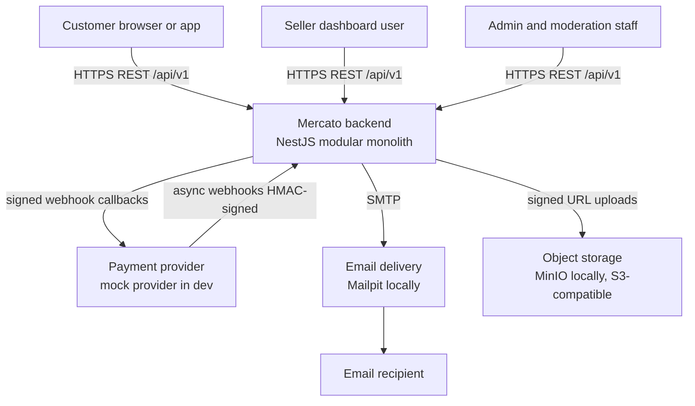
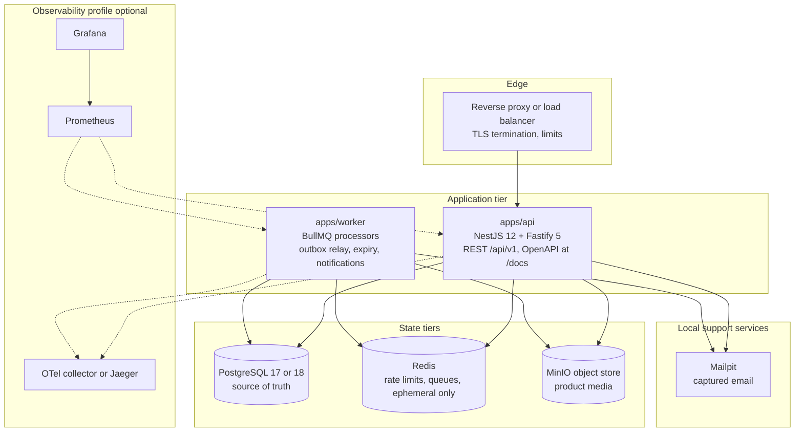

# Mercato — Architecture Overview

Status: Phase 0 (design). This document describes the intended system; nothing here is a claim of a measured or certified result.

## 1. Problem statement

Mercato is a multi-vendor marketplace backend: multiple independent sellers offer products through a shared storefront; customers browse, search, place multi-store orders, pay once per order; sellers fulfill and receive settlement of their share minus marketplace commission.

The hard problems are not CRUD. They are:

1. **Inventory consistency under contention.** Limited stock must never be oversold, even with many concurrent buyers, retried requests, and crashed workers.
2. **Duplicate-payment prevention.** A payment must never be captured twice for the same checkout, even when HTTP responses are lost, webhooks arrive twice or out of order, and clients retry aggressively.
3. **Failure recovery.** Every side effect must survive process crashes: business changes and their outgoing events are committed atomically (transactional outbox), consumers are idempotent, and expired work (e.g. reservations) is recovered by jobs that work even when workers were down.
4. **Least-privilege access control across seven roles.** Sellers, support agents, moderators, and administrators each need a deliberately narrow slice of capability; no role can do another role's job (a seller cannot set payment status or commission; support cannot impersonate administrators).
5. **Auditability.** Financial and moderation actions are traceable to an actor, a request, and a source event.

This is a portfolio project. Its purpose is to demonstrate production-grade engineering discipline (validation at boundaries, concurrency correctness, failure-path testing, security controls) on a realistic domain — not to be a compliance-certified or legally accountable accounting/payments system.

## 2. Quality priorities

When two qualities conflict, resolve in this order:

| #   | Quality         | What it means here                                                                                                                            |
| --- | --------------- | --------------------------------------------------------------------------------------------------------------------------------------------- |
| 1   | Security        | Least privilege, validated input at every trust boundary, no secret leakage, secure defaults. Never traded for convenience.                   |
| 2   | Integrity       | Money and stock are always correct: integer minor units, double-entry ledger balance, no negative available stock, immutable order snapshots. |
| 3   | Reliability     | The system recovers from crashes and duplicates; effects are idempotent and repairable.                                                       |
| 4   | Maintainability | Modular monolith with acyclic module dependencies, strict TypeScript, single source of truth for contracts.                                   |
| 5   | Observability   | Structured logs with request-id/trace-id, redaction, metrics and traces (Phase 8). Enough to debug production behavior.                       |
| 6   | Performance     | Adequate and predictable; optimized only where measurements (k6, Phase 8) justify it.                                                         |

Performance is last on purpose: correctness under concurrency is worth more to this project than raw throughput.

## 3. System context

Actors and external systems around Mercato.



## 4. Container view

Deployable units and state stores. Local development runs all of this via `docker compose`.



Notes on the diagram:

- **PostgreSQL is the transactional source of truth** for orders, inventory, payments state, and the ledger. Redis never holds authoritative business state (ADR-003).
- **The worker is stateless**; all durable work is described by rows in PostgreSQL (`outbox_events`, `inventory_reservations` expiry timestamps, `notification_deliveries`) and materialized into BullMQ jobs for throughput. Losing every Redis job is recoverable from PostgreSQL.
- **Mailpit** captures all outbound email locally so demos and tests never send real mail.
- **Observability** (Prometheus, Grafana, OTel collector) is an optional compose profile; the app works without it (Phase 8 enables full instrumentation).

## 5. Runtime view — a request's life

1. Edge terminates TLS, applies coarse IP rate limits, forwards with `X-Request-Id` preserved or generated.
2. Fastify middleware: request-id/trace-id binding, structured logging (pino) with secret redaction, CORS allowlist check, CSRF checks for cookie-authenticated state-changing requests, session resolution (opaque token, SHA-256 hashed at rest).
3. Route input is validated with zod (packages/contracts); invalid input is rejected with RFC 9457 Problem Details before reaching business logic.
4. Application service in the owning module runs the use case inside a PostgreSQL transaction where multiple writes must be atomic; row locks (`SELECT ... FOR UPDATE`) protect contended resources such as inventory.
5. Business rows and matching `outbox_events` rows commit in the same transaction.
6. Response is serialized from output schemas; errors map to stable Problem Details `code` values.
7. The outbox relay in `apps/worker` publishes events to BullMQ consumers; consumers deduplicate via `inbox_processed_events` and are safe to run at least once.

## 6. Deployment view

- Local demo stack: `pnpm infra:up` starts postgres, redis, minio, mailpit (plus optional observability profile), then `pnpm db:migrate` and `pnpm dev` run api and worker on the host.
- Full-stack demo: the compose file also defines `api` and `worker` images built from `infra/docker`.
- Ports, credentials, and provider settings come from `.env` validated by `packages/config` (zod); no defaults are committed for secrets.
- `infra/deployment` holds the target deployment manifests (single VM or container platform). TLS, backups, and secret storage are deployment concerns documented in [../operations/deployment.md](../operations/deployment.md).
- Migrations run as a separate deploy step with a dedicated migration DB role (ADR-004, [../operations/database-migrations.md](../operations/database-migrations.md)).

## 7. Repository layout

```
apps/api            NestJS modular monolith, one module per bounded context
apps/worker         BullMQ processors: outbox relay, expiry recovery, notifications, media
packages/contracts  zod schemas + zod-openapi generation (single source of truth)
packages/config     environment schema and validation
packages/shared-kernel  uuidv7, money, error types, event envelope
packages/testing    test helpers, factories, integration harness
infra/docker        Dockerfiles, compose file
infra/observability Prometheus/Grafana/OTel configs
infra/deployment    deployment manifests
docs/               this documentation set
tests/              integration, e2e, security, load suites
scripts/            operational and repair scripts
```

## 8. Deliberate non-goals (Phase 0)

- No microservices: bounded contexts are modules in one deployable (ADR-001). Extraction candidates are search/indexing, notification processing, media processing, and analytics (Phase 11).
- No Turborepo yet: 2 apps + 4 packages do not justify the build-graph complexity; `pnpm -r` orchestration is sufficient (ADR-002).
- No JWT for browser sessions (ADR-007).
- No claimed compliance certifications anywhere in this documentation set.

## 9. Related documents

- [domain-boundaries.md](domain-boundaries.md) — 18 bounded contexts, tables, events, invariants
- [database-erd.md](database-erd.md) — data model and database policies
- [checkout-sequence.md](checkout-sequence.md), [payment-workflow.md](payment-workflow.md), [inventory-reservation.md](inventory-reservation.md), [outbox-processing.md](outbox-processing.md)
- [../security/threat-model.md](../security/threat-model.md) and the rest of `docs/security/`
- [../adr/](../adr/) — architecture decision records
