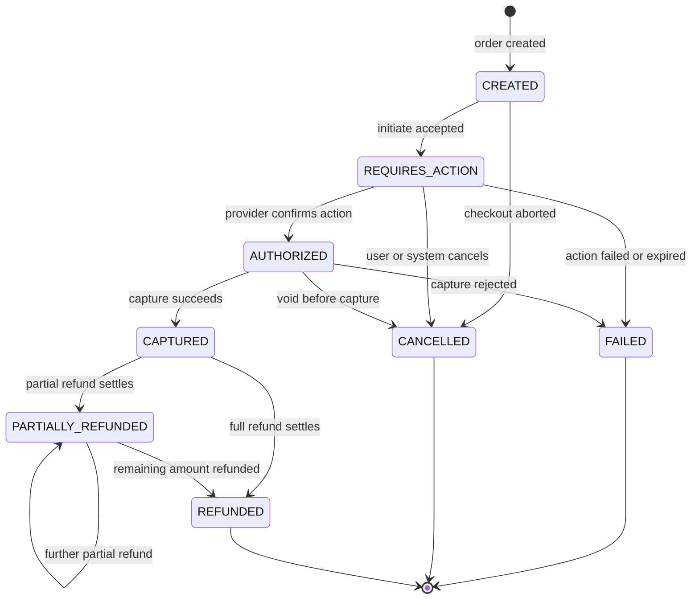

# Payment Workflow

Status: Phase 0 (design). Payments go through a `PaymentProvider` interface with a deterministic mock provider for development and tests. No PAN/CVV is ever stored, logged, or proxied; the mock provider uses tokenized test instruments only. All numbers below are configured defaults, not measured results.

## 1. Payment state machine



Terminal states: `FAILED`, `CANCELLED`, `REFUNDED`. `PARTIALLY_REFUNDED` can progress only toward more refunds.

### 1.1 Transition table

| From               | To                 | Triggered by                                               | Notes                           |
| ------------------ | ------------------ | ---------------------------------------------------------- | ------------------------------- |
| —                  | CREATED            | system (checkout)                                          | always the initial state        |
| CREATED            | REQUIRES_ACTION    | system (payments module, initiate)                         | provider payment created        |
| CREATED            | CANCELLED          | system or customer                                         | checkout abandoned/expired      |
| REQUIRES_ACTION    | AUTHORIZED         | provider webhook `payment.authorized`                      | signature verified first        |
| REQUIRES_ACTION    | FAILED             | provider webhook `payment.failed` or expiry                |                                 |
| REQUIRES_ACTION    | CANCELLED          | customer (before confirm) / system timeout                 |                                 |
| AUTHORIZED         | CAPTURED           | provider webhook `payment.captured` or system capture call | idempotent                      |
| AUTHORIZED         | CANCELLED          | system void (e.g. reservation expired before capture)      |                                 |
| AUTHORIZED         | FAILED             | provider webhook `payment.capture_failed`                  | rare; treated like failure path |
| CAPTURED           | PARTIALLY_REFUNDED | provider webhook `refund.completed` partial                | sum of refunds < captured       |
| CAPTURED           | REFUNDED           | provider webhook `refund.completed` full                   | sum of refunds == captured      |
| PARTIALLY_REFUNDED | PARTIALLY_REFUNDED | further partial refunds                                    | cumulative sum still < captured |
| PARTIALLY_REFUNDED | REFUNDED           | final refund completes                                     | cumulative sum == captured      |

**Forbidden transitions** (rejected with `invalid-payment-transition`, audited): any transition into `CREATED`; `FAILED`/`CANCELLED`/`REFUNDED` → anything; `REQUIRES_ACTION` → `CAPTURED` directly (must pass `AUTHORIZED`); `CAPTURED` → `CANCELLED`; `REFUNDED` → `PARTIALLY_REFUNDED`. Any unknown provider status maps to a rejection + alert, never to a guessed state.

Actors: `system (checkout/payments module)` performs internal transitions; **only provider webhooks or the provider client** move money states (`AUTHORIZED`, `CAPTURED`, `FAILED`, refund states). Customers, sellers, and support staff can _request_ actions (cancel, refund request) but the state change occurs through the payments module after provider confirmation. Sellers can never set payment status directly (see [../security/access-control-matrix.md](../security/access-control-matrix.md)).

## 2. Mock provider contract

Base URL configured via env (e.g. `PAYMENTS_PROVIDER_BASE_URL`); all endpoints require an `Authorization: Bearer <provider-api-key>` header server-to-server.

| Method | Path                          | Purpose               | Request (sketch)                                         | Response (sketch)                                                 |
| ------ | ----------------------------- | --------------------- | -------------------------------------------------------- | ----------------------------------------------------------------- |
| POST   | `/v1/payments`                | initiate              | `{ amount_minor, currency, order_ref, idempotency_key }` | `{ provider_payment_ref, status: "requires_action", action_url }` |
| POST   | `/v1/payments/:ref/authorize` | simulate authorize    | `{ instrument_token }`                                   | `{ status: "authorized" }`                                        |
| POST   | `/v1/payments/:ref/capture`   | capture               | `{ amount_minor, idempotency_key }`                      | `{ status: "captured", captured_amount_minor }`                   |
| POST   | `/v1/payments/:ref/fail`      | simulate failure      | `{ reason_code }`                                        | `{ status: "failed" }`                                            |
| POST   | `/v1/payments/:ref/cancel`    | void                  | `{ reason }`                                             | `{ status: "cancelled" }`                                         |
| POST   | `/v1/payments/:ref/refunds`   | refund                | `{ amount_minor, idempotency_key, reason }`              | `{ provider_refund_ref, status: "processing" }`                   |
| GET    | `/v1/payments/:ref`           | status/reconciliation | —                                                        | `{ status, events: [...] }`                                       |

Every mutating call is idempotent on the provider side via `idempotency_key`; retries reuse the same key and return the same result.

### 2.1 Webhook payload schema

```json
{
  "event_id": "evt_0193...",
  "event_type": "payment.captured",
  "created_at": "2026-10-21T12:00:00Z",
  "provider_payment_ref": "pay_0193...",
  "order_ref": "ord_0193...",
  "data": {
    "amount_minor": 129900,
    "currency": "USD",
    "captured_amount_minor": 129900
  }
}
```

`event_type` values: `payment.authorized`, `payment.captured`, `payment.failed`, `payment.cancelled`, `refund.completed`, `refund.failed`.

### 2.2 Signature scheme

- Header `X-Signature: t=<unix-seconds>,v1=<hex-hmac>` where `v1 = HMAC_SHA256(webhook_secret, "<t>.<raw-body>")` over the **raw request body** (never a re-serialized JSON object).
- Header `X-Timestamp` (or the `t` component) must be within **±120 seconds** (configured default) of server time; older payloads are rejected with `401 webhook-stale` to bound replay.
- Replay protection beyond the window: `provider_event_id` dedupe (below). The timestamp + HMAC binds the payload to the moment; the event-id dedupe makes retries safe.
- Signature comparison uses a constant-time compare. The webhook secret is stored in secret management, never in code or logs; raw webhook bodies are logged only in redacted/truncated form and never with signature headers.

## 3. Idempotency and duplicate/out-of-order webhooks

1. **Verify** signature + timestamp before parsing business meaning. Failures are `401`, counted as security metrics, and the body is not processed.
2. **Dedupe**: `payment_attempts (provider, provider_event_id)` unique constraint. On conflict → return `200` immediately (acknowledged, no side effects). The dedupe row is inserted **inside the same transaction** as the state change, so a crash before commit causes the provider's retry to be processed fully.
3. **State machine guard**: a webhook implying an invalid transition for the current state is either ignored-and-acked (benign reordering, e.g. duplicate `payment.authorized` after `payment.captured`) or rejected-and-acked-with-alert (contradictory, e.g. `payment.failed` after `refund.completed`), depending on whether the target state is already superseded. The rule: **never roll back money states from webhook order alone**; reconciliation resolves contradictions.
4. **Out-of-order tolerance**: handlers are written against the state machine, not arrival order. A late `payment.authorized` after `payment.captured` is a no-op. A late `refund.completed` after `payment.cancelled` (see failure scenario 7) is escalated: refund is applied only if the provider reports the refund as settled, otherwise it is rejected and alerting fires.
5. **Ack contract**: the provider expects `2xx` only when the event is durably recorded (processed or deduped). Any `5xx`/timeout makes the provider retry with backoff — this is our at-least-once contract.

## 4. Failure scenarios and solutions

| #   | Scenario                                                                                | What could go wrong                                                                             | How it is solved                                                                                                                                                                                                                                                                                                                                            |
| --- | --------------------------------------------------------------------------------------- | ----------------------------------------------------------------------------------------------- | ----------------------------------------------------------------------------------------------------------------------------------------------------------------------------------------------------------------------------------------------------------------------------------------------------------------------------------------------------------- |
| 1   | **Response lost** — client's HTTP response after payment initiation or checkout is lost | client retries → double charge                                                                  | Idempotency keys scoped per actor+operation with persisted fingerprint + stored result; retry replays the stored result (see [checkout-sequence.md](checkout-sequence.md#5-idempotency-key-rules)). Provider calls also carry idempotency keys.                                                                                                             |
| 2   | **Duplicate webhook**                                                                   | same event delivered twice → double ledger entries / double fulfillment                         | `payment_attempts (provider, provider_event_id)` unique + `inbox_processed_events` per consumer; duplicates ack with 200 and no side effects. Property test `webhook-duplicate` asserts exactly-once _effect_.                                                                                                                                              |
| 3   | **Payment fails after reservation**                                                     | stock held for a dead payment                                                                   | `PaymentFailed` consumer releases reservations and cancels seller orders; reservation expiry job is a backstop; see [checkout-sequence.md](checkout-sequence.md#41-payment-fails-after-reservation).                                                                                                                                                        |
| 4   | **Worker crash after confirmation**                                                     | capture known to provider, local state stale                                                    | Webhooks are retried by the provider until 2xx after durable record; commit-then-ack means crash → redelivery → clean reprocessing. Reconciliation job (Phase 6) compares `REQUIRES_ACTION`/`AUTHORIZED` payments older than threshold against provider GET status and re-drives.                                                                           |
| 5   | **Order persisted but event publish failed**                                            | downstream (ledger, notifications) never hears about it                                         | Impossible by construction: `outbox_events` inserted in the same DB transaction (ADR-009). Relay publishes with at-least-once; consumers dedupe.                                                                                                                                                                                                            |
| 6   | **Retried refund**                                                                      | refund executed twice → seller/customer over-refunded                                           | Refund requests carry a stable `idempotency_key` persisted on `refunds.provider_refund_ref` (unique); provider call is idempotent; duplicate webhook events deduped as in #2. Cumulative refund sum is CHECKed ≤ captured amount in the same transaction that records `refund.completed`.                                                                   |
| 7   | **Delayed webhook after cancellation**                                                  | `payment.captured` arrives after the order/payment was cancelled (e.g. reservation expiry void) | Handler compares against current state: if payment is `CANCELLED` and a `payment.captured` arrives, the capture is honored at the provider (money moved) but immediately triggers the documented `payment-after-expiry` path: auto-refund the captured amount and keep the order cancelled, with an audit event + alert. Money is never kept without stock. |

## 5. Reconciliation (Phase 6 deliverable)

- Periodic job compares non-terminal payments with the provider's `GET /v1/payments/:ref`.
- Divergences raise operator alerts and can be repaired with `scripts/payment-repair` (re-drive state transitions through the same idempotent handlers).
- Reconciliation is detective; the preventive guarantees are the state machine + idempotency + commit-then-ack.

## 6. Test evidence plan

Named suites (to exist under `tests/`): `tests/security/payment-webhook.test.ts` (signature, replay, tampering), `tests/integration/payment-state-machine.test.ts` (allowed/forbidden transitions), `tests/integration/payment-idempotency.test.ts` (scenarios 1, 2, 6), `tests/integration/payment-recovery.test.ts` (scenarios 3, 4, 5, 7), property tests in `tests/integration/property-payments.test.ts`. Status as of Phase 0: **planned** — this document defines what those tests must prove; none of these suites exists yet.
